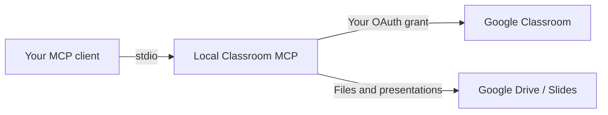

# Google Classroom MCP

## From lesson plan to Classroom draft


[](LICENSE)

[](https://github.com/pengusto/google-classroom-mcp/actions/workflows/checks.yml)

Prepare tomorrow’s teaching materials from the MCP client you already use. Find the right Google Classroom course, check what is there, and turn your resources into assignment, material or announcement drafts before choosing when to publish.

For **teachers and course organizers with teacher access** who want an assistant to help prepare Classroom posts. The server runs locally over **stdio**, connects to your own Google account, and exposes **21 tools** with validated inputs.

| Teaching task | What the server provides |
|---|---|
| Find the right class | Course search by name or section, course details and paginated lists |
| Prepare a session | Topics, assignment and material drafts, announcement drafts |
| Plan publication | Publish explicitly, schedule a draft, reschedule or cancel its schedule |
| Bring the resources | Drive uploads up to 5 MiB, file/link attachments and existing Slides data |

**Status:** `3.0.0-beta.1` development line, with an open dependency-audit release gate (see [Development](#development)). Install from source; this version is not published to npm and the package is intentionally marked `private: true`. The GitHub repository is public. See [release readiness](docs/RELEASE.md) for recorded checks and open gates.

[Quickstart](#quickstart) · [First request](#first-request-start-with-a-read) · [Tool reference](#available-tools) · [Permissions](#permissions-and-limitations) · [Development](#development)



Your MCP client can call write tools with your account’s permissions. New posts default to drafts; publishing is available when explicitly requested.

## Example workflow

After setup, ask your MCP client:

> Find my programming course and check its existing posts, including drafts. Prepare a draft material titled “Session 2 resources” with the Google Slides link I provide. Show me the result and leave it unpublished.

The client can find the course, inspect each page of posts and create the draft. To schedule it later, provide a publication date, time and timezone. Google still controls access and accepted publication dates.

## Quickstart

You need Node.js 24 LTS (Node.js 22 is also checked), **Bun 1.4.2**, an MCP client that supports local stdio servers, and a Google account with teacher access. You also need a Google Cloud project where you can configure Desktop OAuth; Workspace policy may require administrator approval.

### 1. Install and check locally

```sh
git clone https://github.com/pengusto/google-classroom-mcp.git
cd google-classroom-mcp
bun ci
bun run test
```

The build is included in `bun run test`; the tests still run under Node.js. During development, use `bun run build` or `bun run dev`.

### 2. Connect your Google account

1. Create your own Google Cloud project. Enable the **Classroom**, **Drive** and **Slides** APIs.
2. Configure the OAuth consent screen and add your Google account as a test user if the app is in testing mode. Your Workspace administrator may restrict access.
3. Create an OAuth client of type **Desktop app**. Save its downloaded JSON as `credentials.json` in the repository root.
4. Run `bun run auth`. Complete consent in the browser. The local callback saves `token.json` after verifying access.

Keep both files private. They are ignored by Git. To store them outside the checkout, set `GOOGLE_CREDENTIALS_PATH` and `GOOGLE_TOKEN_PATH` to absolute paths for both authentication and the MCP process. A local `.env` can supply these variables when commands run from the repo root; clients launched elsewhere should pass them explicitly.

### 3. Register the server in your MCP client

Adapt this configuration to your client. Replace every `/path/to/…` value with an absolute path on your machine. The example uses credentials outside the checkout; use the same paths during `bun run auth`. Launch the built JavaScript with Node, as shown here.

```json
{
  "mcpServers": {
    "google-classroom": {
      "command": "node",
      "args": ["/path/to/google-classroom-mcp/dist/index.js"],
      "env": {
        "GOOGLE_CREDENTIALS_PATH": "/path/to/private/credentials.json",
        "GOOGLE_TOKEN_PATH": "/path/to/private/token.json"
      }
    }
  }
}
```

### First request: start with a read

Restart or reconnect your MCP client, then ask:

> List one page of my Classroom courses. Do not change anything. Tell me whether there are more pages.

The corresponding tool call is `classroom_list_courses` with:

```json
{"pageSize": 1}
```

Expect an `items` array and a `nextPageToken` that is either a string or `null`. Once the connection works, try the [draft workflow](#example-workflow) with a course you have chosen. Read the [pagination rules](#read-every-page) before asking the client to inspect all existing posts.

### Diagnose setup without opening a browser

Run `bun run doctor` with the same environment as your MCP client. It checks OAuth files/scopes and makes small read-only Classroom and Drive requests. It never starts a consent flow or creates posts. Errors distinguish missing files, invalid JSON, permissions, revoked access and API configuration. It does not print credential values or course content. Slides and participant access need separate checks.

Restart the MCP connection after rebuilding. The server uses stdout only for MCP messages; operational messages go to stderr.

## Available tools

The authoritative argument schemas are returned by `tools/list`. Unknown arguments and invalid types, dates or change masks are rejected before contacting Google.

| Area | Tools |
|---|---|
| Courses | `classroom_list_courses`, `classroom_search_courses`, `classroom_get_course`, `classroom_update_course` |
| Topics | `classroom_list_topics`, `classroom_get_topic`, `classroom_create_topic`, `classroom_patch_topic` |
| Assignments | `classroom_list_assignments`, `classroom_get_assignment`, `classroom_create_assignment`, `classroom_patch_assignment` |
| Materials | `classroom_list_materials`, `classroom_get_material`, `classroom_create_material`, `classroom_patch_material` |
| Announcements | `classroom_list_announcements`, `classroom_post_announcement`, `classroom_patch_announcement` |
| Files and slides | `drive_upload_file`, `slides_get_presentation` |

Roster management, grading, guardians and deletion tools are not included. Assignments support ordinary assignments and short-answer questions; multiple-choice creation is not offered in this beta.

### Read every page

All list tools and course search return **one page**:

```json
{"items": [], "nextPageToken": "next-page-token"}
```

Pass `nextPageToken` as `pageToken` in the next call, retaining the same filters and `pageSize`. Stop only when the token is `null`. Search filters one Google page at a time, so an empty `items` array can still have a continuation token. `pageSize` defaults to 50 and accepts 1–100; `fullData: true` requests complete objects, which can be large.

Assignment, material and announcement lists include published posts and drafts by default. Override `courseWorkStates`, `courseWorkMaterialStates` or `announcementStates` to narrow the result. Google still enforces what your account may see.

### Prepare, then publish

New assignments, materials and announcements default to **DRAFT**. Pass `state: "PUBLISHED"` explicitly to publish now. To schedule, provide an RFC 3339 `scheduledTime` with timezone; do not combine it with `state: "PUBLISHED"`.

```json
{
  "courseId": "course-id",
  "title": "Session materials",
  "state": "DRAFT",
  "attachments": [{"type": "driveFile", "idOrUrl": "drive-file-id"}]
}
```

Use that payload with `classroom_create_material` to prepare an unpublished material. For scheduling, add `scheduledTime` with your intended upcoming publication time, including its timezone; do not copy a fixed example date. Existing assignment, material and announcement posts can be updated by ID with an `updateMask`, for example `"scheduledTime"`, plus the named field. To cancel a scheduled publication, patch `scheduledTime` with `null`; the server sends the field mask without a timestamp. Very distant publication dates can be rejected by Google. Every mask field must be supplied; empty strings can clear supported text fields. Due dates and times use **UTC**, independently of the scheduled publication timezone.

Before writing, inspect all existing pages and drafts. After an uncertain response, re-read the target before retrying: the operation may have succeeded. This server does not claim exactly-once creation or automatically deduplicate posts. Google can restrict modifications to posts created by the same developer project. Classroom's visible order must be checked separately from API response order.

### Attach a file

Call `drive_upload_file` with `name`, optional `mimeType` and canonical `base64Content`, up to **5 MiB** decoded. Save the returned file ID, then attach it in a separate material or assignment call. The server does not delete the uploaded file if attaching it fails. Larger files can be uploaded through Drive and referenced by ID.

Attachment types are `driveFile`, `link`, `youtubeVideo` and `form`, each with `idOrUrl`. External links must use HTTP or HTTPS. Verify participant access separately; a teacher's ability to read a file does not prove students can open it.

## Permissions and limitations

OAuth requests Classroom read/write scopes for courses, student coursework, materials, topics and announcements, plus `drive.file` and `drive.readonly`. The latter permits broad read access to Drive files and supports reading existing Slides. The server does not request roster, guardian or profile scopes. Google credentials may carry permissions beyond the exposed tools; keep tokens private.

The server stores OAuth tokens locally with owner-only permissions and persists refreshed tokens. It does not log API response bodies or credential values. Authentication failures include next steps; uncertain write failures instruct the caller to verify the target. See [SECURITY.md](SECURITY.md).

Offline tests validate MCP behavior, request construction, upload bytes and token handling. Draft creation, scheduled-time changes, cancellation and a real file attachment have also been verified in a dedicated Google test course. Fresh Google consent, automatic publication at the scheduled time and participant file access remain separate release checks. See [docs/RELEASE.md](docs/RELEASE.md).

## Troubleshooting

| Symptom | Next check |
|---|---|
| OAuth file missing or invalid | Check the absolute paths passed to both authentication and the MCP client; use downloaded Desktop credentials |
| Access denied | Check enabled APIs, granted scopes, teacher role, consent test users and Workspace policy |
| Expired or revoked grant | Run `bun run auth` again with the same credential and token paths |
| Server still exposes old behavior after a change | Run `bun run build`, then restart the MCP connection |
| A search page is empty but has a token | Continue with `pageToken`; search filters one Google page at a time |

### Name displayed as “Unknown User”

When using this integration, Google Classroom may display a name as **“Unknown User”**. This has been reported as potentially dependent on Google Workspace administrator settings; the exact cause and affected settings have not yet been independently verified. If it occurs, ask your Workspace administrator to review the relevant account and application settings. No confirmed workaround is documented yet.

## Development

See [CONTRIBUTING.md](CONTRIBUTING.md). Run `bun run test` and `git diff --check` before submitting changes. CI runs on Node 22 and 24 and includes a redacted Gitleaks scan. High/critical dependency findings fail CI. The [2026-10-22 check](https://github.com/pengusto/google-classroom-mcp/actions/runs/39724177965) reported **five high and one critical advisory** in the existing locked dependency tree: `@modelcontextprotocol/sdk`, `brace-expansion` and `proxy-addr`. This supersedes the earlier moderate-only assessment in release readiness. Dependency remediation and a passing audit remain release gates; passing offline tests does not clear them. The audit reports package findings, not confirmed exploitability of this local stdio setup.

## Migrating from 2.x

- List responses changed from arrays to `{items, nextPageToken}`. Traverse pages explicitly.
- New posts default to drafts; immediate publication is explicit.
- Announcement patches require `updateMask` and support state/scheduling.
- Unsupported administrative tools and inherited live tests targeting a hard-coded course were removed.
- `bun run auth` builds before login. Only Desktop OAuth credentials are supported.

No legacy response adapter is included.

## License and attribution

Based on [adriasantacreu/google-classroom-mcp](https://github.com/adriasantacreu/google-classroom-mcp). [MIT](LICENSE). Original work by Adrià Santacreu i Giménez and contributors; maintained and extended by Pengusto. See [provenance](docs/PROVENANCE.md) for the source of the license declaration and attribution. This is an independent project, not an official Google product.
